  

 

  

### ⚡ What I build

### 🧰 Toolbox

### 🚀 Projects

  
  
  
  

### 📈 Activity

<picture>
  <source media="(prefers-color-scheme: dark)" srcset="https://raw.githubusercontent.com/syed-mehraj/syed-mehraj/output/github-snake-dark.svg" />
  <source media="(prefers-color-scheme: light)" srcset="https://raw.githubusercontent.com/syed-mehraj/syed-mehraj/output/github-snake.svg" />
  
</picture>

<!-- Every animation above is a hand-written SVG (scripts/). Activity refreshes daily via .github/workflows/profile.yml. -->
