  

  
  
  

I'm a **full-stack developer and AI engineer** 💻🤖, studying **AI & Machine Learning at MJCET, Hyderabad** 🎓 (class of 2027) and working as a developer at **Parallel Labs** 🏢. I like owning a product end to end: **web frontends** in React and Next.js 🎨, **backends and APIs** in Node.js and NestJS with PostgreSQL and Kafka 🛠️, **mobile apps** with Expo and Kotlin 📱, and the **AI layer** on top: LLMs, RAG, fine-tuning and real-time voice agents 🎙️. I'm always happy to learn something new and to collaborate on interesting projects 🤝.

- 🎨 **Frontend:** React, Next.js, TypeScript, Tailwind CSS
- 🛠️ **Backend:** Node.js, NestJS, PostgreSQL, Prisma, Kafka, REST APIs, microservices
- 📱 **Mobile:** Expo (React Native), Kotlin
- 🤖 **AI / ML:** LLM apps, RAG, LoRA fine-tuning, voice agents, PyTorch, TensorFlow, scikit-learn
- ☁️ **Shipping:** Docker, Vercel, CI pipelines, Git
- 📍 Based in **Hyderabad, India**

<h2 align="center">Technology Stack 💻</h2>

  
  
  
  
  
   
  
  
  
  
  
   
  
  
  
  
  
  
  
   
  
  
  
  
  
  
   
  
  
  
  
  
  

<h2 align="center">Skills 🧠</h2>

| Frontend | Backend | Mobile | AI / ML | Tools |
| :---: | :---: | :---: | :---: | :---: |
|  |  |  |  |  |

<h2 align="center">My GitHub Stats 📊</h2>

  
  

  

<h2 align="center">Projects 🚀</h2>

| Project | What it does | Built with |
| --- | --- | --- |
| [Heart Disease Prediction](https://github.com/syed-mehraj/Heart-disease-prediction) | A TensorFlow/Keras network compared with linear SVM and Naive Bayes, after cleaning and EDA | Python, TensorFlow, scikit-learn |
| [Ensemble Learning](https://github.com/syed-mehraj/Ensemble-learning) | Voting, bagging, boosting and stacking compared on the Iris dataset | scikit-learn, XGBoost |
| [Cattle Breed Recognition](https://github.com/syed-mehraj/cattle-breed-prediction) | A notebook that learns to tell cattle breeds apart | Python, Jupyter |
| [Student Performance](https://github.com/syed-mehraj/Edulumus_Internship_Tasks) | EDA and regression models that predict exam scores (Edulumus internship) | Pandas, scikit-learn |

<h2 align="center">IDE / Tools I like 🛠️</h2>

  
  
  

